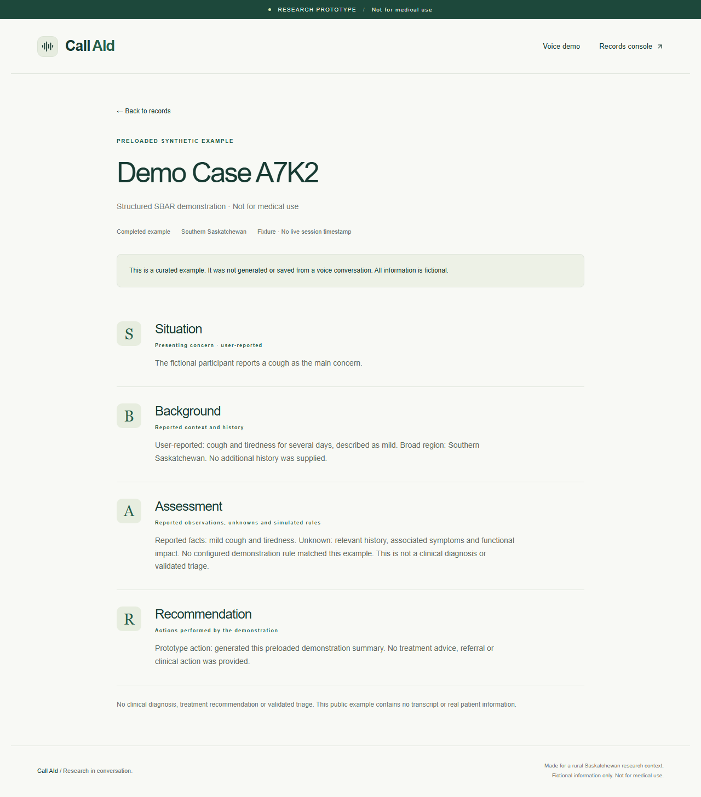

# Call AId

**Not for medical use.** Public browser voice research prototype for rural Saskatchewan. Use fictional information only. No diagnosis, prescription, validated triage, clinical referral, telephone integration or real patient processing.

Call AId explores whether browser voice AI can help organize symptom intake in rural Saskatchewan. A visitor describes invented symptoms, answers relevant follow-ups, reviews a recap and receives a structured report. It is a demonstration of information capture, with no real patient processing.

Milestones 1–3 provide trusted Supabase persistence and a public records console alongside Python-controlled intake, Pydantic validation and simulated screening. No authentication, scenario gate or acknowledgement form. **Milestone 4 is in preparation; final production publication requires owner approval. Public demo URL: pending deployment.** See [Milestone 4 status](MILESTONE_4_REPORT.md).

## Features and screenshots

- Public landing, browser microphone selection/input meter, mute and end controls.
- Relevant conditional questions, caller corrections and reviewed spoken recap.
- Deterministic simulated flags and constrained, validated SBAR templates.
- Idempotent trusted saves and truthful saved/failed/incomplete outcomes.
- Public recent-case statistics, formatted reports and JSON, with separate offline examples.
- Configurable session, concurrency, rate and usage limits; no login or clinical-service integration.

Screenshots contain synthetic data only:




Review the spoken recap, correct important details, confirm it, and let the agent finish its goodbye. It waits for the backend save result, acknowledges the reported concern warmly, wishes you well and explains the actual saved/failed/withheld outcome. A successful saved record is never described as temporary. The room closes after the farewell; clicking End Session or disconnecting early can cut off spoken confirmation, while status polling still recovers the database result. `/demo` shows **Preparing report**, then **View Generated Record** only after a confirmed saved public record. Incomplete, withheld and failed outcomes remain distinct. Approved records expire after seven days; static examples are separately identified and excluded from database statistics. See [Milestone 3](MILESTONE_3_REPORT.md), [closing update](CLOSING_UPDATE.md) and the [migration review](supabase/MIGRATION_REVIEW.md).

## Architecture

Browser → Next.js reservation/token → LiveKit realtime agent → Python-validated SBAR and publication gate → atomic Supabase finalization → receipt-bound status → public dashboard/detail. Live drafts remain transient room data. The browser publishes microphone audio only; recording, text input/output and video are disabled. Only sanitized approved SBAR JSON and private operational session state are persisted. No audio, transcripts, rejected narratives or caller identifiers enter database persistence.

`agent/src/intake.py` owns conditional questions, corrections, unknowns, turn limits and review/completion. `intake_schema.py` defines strict Pydantic models; `rules.py` contains versioned simulated markers; `sbar.py` assembles approved templates. `intake_agent.py` connects these to LiveKit tools and committed conversation events. The model interprets meaning and phrases questions; it cannot write database records, choose clinical urgency or supply arbitrary SBAR narratives. The recap must finish playing before a subsequent caller confirmation can mark it reviewed. An interrupted or corrected recap requires another review.

Only bounded categories enter reports. `publication.py` preserves all schema-approved symptom/background categories without count or combination rejection rules. Specific details map to an approved broader category (including fixed “other” templates), or remain unknown when no faithful mapping exists. Identifying details and original wording never enter the public schema. Safe partial or empty intakes can save as incomplete reports. `assessment.public_data_handling` records projection policy `projection-1.1`, generalized fields and whether details were omitted; the console explains these reductions. This reduces disclosure but proves neither anonymity nor fictional input. Quotes and SDK context exist transiently in worker memory and are not persisted. Invalid schema/session state or database failure cannot produce a success claim. See [publication changes and verified new test cases](PUBLICATION_UPDATE.md). No migration or environment change is needed for this policy update.

`persistence.py` freezes one candidate and makes bounded identical retries. A service-only SQL transaction locks the session, permits one record, rejects conflicting retries and atomically derives saved metadata/text. The model has no save/publication tool. Failed or withheld cases create no public record. Server reads validate the published schema again before rendering. The `private` schema is not Data API exposed; narrow, explicitly granted `public` RPCs reach it, with an empty function search path. Anonymous/authenticated roles cannot read or write tables or execute these RPCs. [Supabase database functions](https://supabase.com/docs/guides/database/functions).

Migration 004 adds `save_demo_record_for_closing`: confirmed records can save while audio remains connected, but the active capacity reservation is held until room shutdown. The model receives only trusted closing facts (`record_saved`, public availability, record status and the generalized reported concern), never authority to choose a save result. `finish_demo_session` releases capacity using the stored case status. Post-disconnect finalization remains the fallback. The intake workflow, screening rules and SBAR structure are unchanged; only draft recommendation wording drops “temporary.”

The real voice-to-saved-report acceptance check passed with case `b24de479-0742-4b02-8aa5-6ff8457b6eb6`. With the local server running, open [that report](http://localhost:3001/records/b24de479-0742-4b02-8aa5-6ff8457b6eb6) before its seven-day expiry. This used actual LiveKit/Supabase services and a synthetic microphone, not preloaded data. Hosted web/worker deployment remains deferred.

Public routes: `/`, `/demo`, `/records`, `/records/[id]`. Records show actual database counts, recent published cases and detailed SBAR, plus separate curated examples for offline review. Public reads do not depend on the voice kill switch. Record routes are dynamic with no-store database fetches; dashboard refreshes every 15 seconds and on focus. Status polling is bounded to about 45 seconds, with a manual retry. All secrets stay server-side. Supabase Auth is unused.

`web/` is Next.js 15.5.28 / React 19 / TypeScript / Tailwind 4. `agent/` is Python 3.12+ / LiveKit Agents 1.8 / Pydantic. `supabase/` contains private session/record tables and service-only RPCs. No Redis, extra API server, queue or scheduled automation is required. The release patch updates Next.js from 15.5.27 and pins its PostCSS dependency to 8.5.23 to address published security advisories without a framework major upgrade.

### Server environment reference

Use the placeholders in `web/.env.example` and `agent/.env.example`; never commit configured env files or put credentials in `NEXT_PUBLIC_*`.

| Variables | Runtime | Purpose |
| --- | --- | --- |
| `LIVEKIT_URL`, `LIVEKIT_API_KEY`, `LIVEKIT_API_SECRET` | Web; local agent | `wss://<project>.livekit.cloud` and server credentials |
| `LIVEKIT_AGENT_NAME` | Both | Matching dispatch name, `call-aid` |
| `SUPABASE_URL`, `SUPABASE_SECRET_KEY` | Both | `https://<project>.supabase.co` and server-only secret/service role |
| `SESSION_HMAC_SECRET` | Web | At least 32 random bytes for private buckets |
| `APP_ORIGIN` | Web | Exact canonical website origin; HTTPS when hosted |
| `DEMO_ENABLED` | Web | `false` disables new calls; records/examples remain readable |
| `DEV_UNLIMITED_SESSIONS` | Local next-dev only | Cumulative usage bypass; never available on Vercel/production |
| `MAX_CALL_SECONDS`, `MAX_CONCURRENT_SESSIONS` | Web | Default 180 seconds / 1 active session |
| `MAX_STARTS_10_MINUTES`, `MAX_STARTS_PER_DAY`, `MAX_GLOBAL_STARTS_PER_DAY` | Web | Default 2 / 5 / 10 starts |
| `MAX_DAILY_VOICE_SECONDS` | Web | Default 900 reserved voice seconds |
| `MONTHLY_BUDGET_MICRODOLLARS`, `RESERVED_COST_MICRODOLLARS` | Web | Default 2,000,000 cumulative estimate / 150,000 per reservation |
| `REALTIME_MODEL`, `REALTIME_VOICE` | Agent | Tested `google/gemini-3.8-live` / `Puck` |
| `IDLE_SECONDS`, `MAX_USER_TURNS` | Agent | Default 45 seconds / 20 turns |

LiveKit Cloud automatically injects its own LiveKit URL/key/secret into a hosted agent. Do not upload these as agent secrets. Upload Supabase credentials, dispatch name and model/idle settings only.

## Local setup

Install Node.js 24, pnpm 9.15.9, Python 3.12 and uv. LiveKit CLI is needed for cloud configuration/deployment. Docker plus Supabase CLI are needed only to run the full local Supabase stack; the targeted SQL tests also run through PGlite without Docker.

Dependencies are pinned by `web/pnpm-lock.yaml` and `agent/uv.lock`. This session downloaded project-local tools into ignored `.tools/`; they are not part of the portable project. Normal installed `pnpm`, `uv` and `lk` work with the commands below.

### 1. Explore the website and fixtures without credentials

```powershell
cd web
pnpm install --frozen-lockfile
Copy-Item .env.example .env.local
pnpm dev
```

Open http://localhost:3000. Keep `DEMO_ENABLED=false` until the services below are configured. The landing page, example dashboard and example detail pages work immediately. Voice requests return a safe unavailable message while disabled. No sample LiveKit assistant is used.

### 2. Configure Supabase admission state

Create a development Supabase project. Review migrations in `supabase/migrations/`, run `pnpm dlx supabase@3.0.0 db push --dry-run --remote` against the linked project, then apply only after approval. This workspace has migrations 001–004 applied: 003 fixes finalization and 004 enables save-before-goodbye while preserving capacity. See [migration review](supabase/MIGRATION_REVIEW.md). Do not reapply old SQL or reset the hosted database.

For a disposable local database, start Docker, then from the repository root:

```powershell
supabase start
supabase db reset
```

The migrations create `private.demo_sessions` and `private.sbar_records`, with RLS and no anonymous/authenticated grants. Service-only `public` RPCs provide admission, receipt lookup, finalization, public projections and cleanup. Server credentials bypass RLS, so trusted code and SQL enforce limits and publication. No publishable key or browser database client is needed. Operational identifiers and exact timestamps stay private; reports contain generated case labels and generalized Saskatchewan dates. No region is inferred or collected in this version.

Put `SUPABASE_URL` and the server secret/service-role key in **both** `web/.env.local` and `agent/.env.local`. Never use privileged keys in `NEXT_PUBLIC_*`. The SQL functions are the only database boundary used here. Keep the private schema out of Supabase's exposed-schema list.

### 3. Configure LiveKit

Create a LiveKit Cloud Build project. Obtain the WebSocket URL, API key and API secret. Set them in both env files. Use the same `LIVEKIT_AGENT_NAME=call-aid` for web and agent. Disable development token servers, recordings and transcript observability exports in the project; the Python code also explicitly uses `session.start(record=False)`.

The tested realtime configuration is `google/gemini-3.8-live` with voice `Puck`, using `livekit.agents.inference.RealtimeModel`. See [the milestone 2 report](MILESTONE_2_REPORT.md) for actual test results and limitations. Other realtime models have different cost/voice settings; change the model/voice together after consulting the [Inference catalog](https://docs.livekit.io/agents/models/inference/). No direct model-provider API key is needed.

Generate a random HMAC secret for the web server, for example with this local command, then copy its output directly into `SESSION_HMAC_SECRET` in the local env file (never into chat or Git):

```powershell
node -e "process.stdout.write(require('crypto').randomBytes(32).toString('hex'))"
```

Set `APP_ORIGIN=http://localhost:3000` locally. Set `DEMO_ENABLED=true` only when database migration, credentials and a running agent are ready. Restart Next.js after changing environment variables.

### 4. Start the agent in another terminal

```powershell
cd agent
Copy-Item .env.example .env.local
# Fill the credentials before running dev.
uv sync --locked
uv run src/agent.py dev
```

No separate STT/TTS plugins or model asset download is required by this realtime configuration. The agent only accepts a room with a valid, single-use server reservation. Normal browser flow creates that reservation. Sending it arbitrary rooms or the generic Playground will be rejected by design.

Click Start Voice Session, permit the microphone, and use headphones. A cold start may take several seconds. Speak an ordinary fictional symptom description. The assistant should continue naturally, ask relevant follow-ups, refuse actual clinical advice and confirm saving only after the backend confirms it. The connected screen includes a microphone selector and input-level meter: check that the meter moves while speaking, and choose another input if it stays flat. Review/correct the recap, confirm it and let the goodbye finish. Use mute or End Session to stop.

## Limits and failure behavior

For repeated local testing, set `DEV_UNLIMITED_SESSIONS=true` in `web/.env.local` and run `pnpm dev`. This disables application-level start counts, daily reserved voice-time totals and monthly estimated-budget admission checks. Existing reservation history is kept and does not block this mode. The flag works only with `NODE_ENV=development`, a loopback `APP_ORIGIN`, and outside Vercel; production always uses the configured caps. No database migration is needed. It keeps authentication-free infrastructure protections, concurrency, per-call duration, idle timeout and turn limits. LiveKit's own credits/quotas still apply. Set the flag to false to resume normal metering; existing reservations then count again.

Configure limits in `web/.env.local`: default one active session, 180-second conversation, connection/finalization grace, rolling start limits, daily voice allowance and a conservative per-session cost reservation. `agent/.env.local` controls idle timeout (45 seconds) and user-turn cap (20). Database reservations serialize across server instances and remain counted for budgets even after an error. Token expiry alone does not end a connected call: the worker enforces the deadline and deletes the room. The browser End endpoint also deletes it.

Rate limiting uses server-keyed HMAC network/browser buckets, never raw IP storage. Hosted code trusts Vercel's overwritten `x-vercel-forwarded-for`, not arbitrary forwarding headers; local development shares one network bucket. Shared networks may hit limits collectively. IP/cookie rotation can bypass individual friction; global caps remain. All configuration checks fail closed. `DEMO_ENABLED=false` disables new calls. The active worker still enforces existing deadlines.

Budget reservations are estimates, not exact token-based billing limits. Check actual project credit balance and other development usage before sharing. A busy service, missing configuration or expired credit must leave examples viewable. No automatic paid upgrades. Sanitized demonstration records expire after seven days; run the existing trusted cleanup function daily (see below).

**Launch blocker found November 9:** testing already recorded 31 monthly reservations totaling 4,500,100 estimated microdollars, including 21 starts / 3,780 seconds that day. Default production limits would therefore refuse new calls. Do not erase this accounting or enable a production bypass. Confirm the owner's actual plan/remaining credits, then choose bounded cumulative launch thresholds that include existing history. Keep `DEMO_ENABLED=false` until those limits are reviewed. An estimated reservation total is not the actual LiveKit invoice or credit balance.

## Targeted checks

From `web/`:

```powershell
pnpm lint
pnpm typecheck
pnpm test
pnpm build
pnpm exec playwright install chromium
pnpm test:e2e
```

The SQL tests apply the actual migration to a disposable PGlite PostgreSQL instance. They cover permissions, concurrency, one-time claims, rolling limits and non-refunded budget reservations. PGlite does not test Supabase's hosted PostgREST gateway or multi-connection lock contention; those remain hosted integration checks. Connected-microphone component regressions exercise the real device-selection hook with synthetic browser devices. Browser tests use synthetic microphone input and check anonymous navigation, SBAR fixtures, responsive overflow, unavailable service, microphone denial and unknown record IDs. The unavailable-service response is mocked so routine browser tests do not consume LiveKit credits. They do not prove real voice/model behavior. Set `PLAYWRIGHT_BASE_URL` to test an already-running local server on another port, such as http://localhost:3001.

From `agent/`:

```powershell
uv run ruff check src tests
uv run ruff format --check src tests
uv run pytest
```

These cover adaptive intake, unknowns/corrections, simulated rules, grounded templates, review delivery, bounded leases and lifecycle wiring. An admitted call disables recording and deletes the room; unreserved jobs never initialize inference. Scripted tests do not establish model understanding or audio quality. `scenarios.yaml` includes synthetic headache correction, abdominal unknowns, prompt injection and clinical-advice checks for optional cloud simulation. See the milestone 2 report for the separate actual audio/browser results. Extensive automation is deferred.

For live verification, use the actual browser path and inspect content-free status/logs. `src/agent.py` requires a trusted reservation; do not weaken admission for the debugger. The separate synthetic-only `debug_intake.py` exercises the same Assistant without database access:

```powershell
cd agent
lk agent debugger start --audio --idle-timeout 3m debug_intake.py
lk agent debugger say "I have a headache that began gradually yesterday."
lk agent debugger say "Actually, it began today."
lk agent debugger stop
```

The CLI needs the existing LiveKit project credentials/configuration as well as the agent's env file. Debugger audio uses additional inference TTS credits; its temporary logs/history must contain synthetic input only. Never enter real patient information or enable transcript exports/DEBUG logging for public visitors. Regular tests run offline; paid cloud simulations remain opt-in, outside CI.

For a focused, synthetic closing check, use `tests/closing_probe.py` instead of `debug_intake.py`. Set `CLOSING_PROBE_OUTCOME` to `published`, `failed` or `withheld`, and optionally `CLOSING_PROBE_CONCERN` to `headache`, `cough` or `back_pain`, before starting the debugger. This harness seeds a known recap and uses a **mocked database**; it tests real-model wording, consumes inference credits and creates no Supabase records. These variables are test-only, not application configuration. Confirm the spoken recap, inspect the tool result and reply, then stop the debugger.

Regenerate the shared JSON Schema, controlled value labels and synthetic fixtures after changing Pydantic contracts: from `agent/` in PowerShell, set `$env:PYTHONPATH="src"`, then run `uv run python export_contract.py`. The web validates received JSON at runtime with strict Zod models and approved templates. Python is canonical; cross-language fixtures and targeted tests detect drift. No transcript is sent through the preview channel or stored in browser storage.

## Deployment and release

Final production publication requires owner approval. No paid upgrade, domain purchase or additional deployment slot is authorized. Current verified status is in [MILESTONE_4_REPORT.md](MILESTONE_4_REPORT.md).

1. Authenticate Vercel CLI (`vercel login`), inspect existing projects and link the existing [GitHub repository](https://github.com/fikunmi-2/call-aid). Inspect its Git integration before pushing `main`, since a connected production branch can auto-deploy. Configure **Root Directory = web**, **Framework = Next.js**, **Node = 24.x**, install `pnpm install --frozen-lockfile`, build `pnpm build`, default Next.js output. `.vercelignore` excludes local secrets, tools, Python source and caches.
2. Set server environment variables separately for Preview/Production. Enter secrets through the dashboard or CLI stdin, never literal command-line values. Keep `DEV_UNLIMITED_SESSIONS=false`. Set canonical `APP_ORIGIN=https://<project>.vercel.app`. Preview alone also accepts exact Vercel-provided `VERCEL_URL`/`VERCEL_BRANCH_URL` origins; caller-controlled forwarding headers cannot authorize a site. Production accepts the configured canonical origin only.
3. Inspect the current LiveKit project with `lk agent list` before creation; current inspection found no hosted agent. From `agent/`, test `uv run src/agent.py start`. After deployment approval, use `lk agent create --region us-east --secrets-file <private-agent-secrets-file>`. The first create uses LiveKit's reserved **production** slot, so obtain owner approval first if production publication is held. `us-east` is the currently documented North American hosting region, not a Canadian-residency guarantee.
4. Keep generated `agent/livekit.toml` IDs in Git, without secrets. Use `lk agent deploy` for later updates, not another create. Configure only permitted agent secrets through `lk agent update-secrets --secrets-file <private-agent-secrets-file>` without `--overwrite`. Inspect `lk agent status`, `lk agent secrets`, `lk agent versions`, build/deployment logs and the matching `call-aid` dispatch name. Disable recording/transcript exports. No local Docker engine is available here, so a local image build is unverified.
5. Deploy a Vercel preview with `vercel deploy` **without `--prod`**. Review deployment protection; an owner-protected preview is not a public judge release. Stop every local Python worker for hosted acceptance so it cannot satisfy dispatches. Open the HTTPS preview anonymously, allow microphone, complete an invented intake, correct/confirm recap, hear the warm saved closing, follow **View Generated Record**, and verify the same new case on `/records`. Check database confirmation, safe JSON, freshness, mobile/desktop and failure states. Unrun checks stay unverified.
6. Present the tested preview, source commit, final limits and migration state for owner approval. Only afterward publish production, verify its canonical HTTPS origin/routes again, push reviewed commits as appropriate, and replace the pending public URL in this README/report. Do not reset hosted Supabase; migrations 001–004 are already applied and its dry run is up to date.

Rollback: disable new sessions with `DEMO_ENABLED=false` and redeploy the web app; records/examples remain readable. Revert to a known web deployment through Vercel and use `lk agent rollback --version <known-version>` when a previous agent version exists. A first agent deployment has no earlier version. Do not roll back by resetting/deleting database data. See [official agent deployment](https://docs.livekit.io/deploy/agents/quickstart/), [secrets](https://docs.livekit.io/deploy/agents/secrets/) and [quotas](https://docs.livekit.io/deploy/admin/quotas-and-limits/).

At initial implementation, cloud credentials were unavailable. Local setup subsequently verified admission, LiveKit audio and structured intake. Milestone 3 verified actual cloud persistence, the public report link, hosted Data API exposure, RLS enablement and service/anonymous role grants. Local env files remain ignored. Broader security/model testing and hosted web/worker deployment remain unverified. See the milestone reports for results. The local dev URL is http://localhost:3001; keep `APP_ORIGIN` equal to the browser URL.

## Starter and skill provenance

- Web foundation: [livekit-examples/agent-starter-react](https://github.com/livekit-examples/agent-starter-react), commit `9e1fc2f40fd7ceaccbe4a872b21765b49eefea80`. Reused dependency/config conventions and token endpoint foundation; replaced unrestricted token grants and removed unused starter features. MIT license retained in `web/LICENSE`.
- Python foundation: [livekit-examples/agent-starter-python](https://github.com/livekit-examples/agent-starter-python), commit `228095c442fcb259c80e9786fc0d7c5534e6af46`. Adapted AgentServer entry point, uv project and Dockerfile to native realtime and server reservations. MIT license retained in `agent/LICENSE`.
- Official [LiveKit Agent Skills](https://github.com/livekit/agent-skills), commit `e1195b497388b1aecad5dd2e9a0c9bdfbaba1878`, were installed manually by copying their skill directories into `agent/.agents/skills`, as supported by the [installation docs](https://docs.livekit.io/reference/developer-tools/agent-skills/). These are local developer tools excluded from Git; install them locally when needed. No global Codex settings were changed. The project-local CLI is 2.19.3 and installed Python SDK is 1.8.10.

Run `select public.cleanup_demo_records();` through a trusted maintenance connection daily (or schedule the same function in Supabase). It deletes up to 500 expired public records per run, clears old receipt/network hashes and keeps current billing-month accounting. Expired records are immediately excluded from reads even before cleanup. Never call cleanup from the browser. Initial retention is seven days; current usage caps make one daily batch sufficient.

Draft contracts remain schema 2.0; confirmed published records use schema 3.0 and publication policy `public-1.0`. `publication`, `record_saved` and saved recommendation text come from the SQL result, never model updates. Existing env files are sufficient: there are **no new application environment variables**. Supabase CLI login/project linking is tooling configuration only.

The GitHub workflow runs cloud-free Python, web, SQL and desktop/mobile browser checks with read-only repository permissions. Its hosted Actions execution is unverified until pushed; cloud simulations remain opt-in. Review the approved [project plan](PROJECT_PLAN.md) and [Milestone 4 report](MILESTONE_4_REPORT.md) for remaining release gates. No user authentication is introduced.
