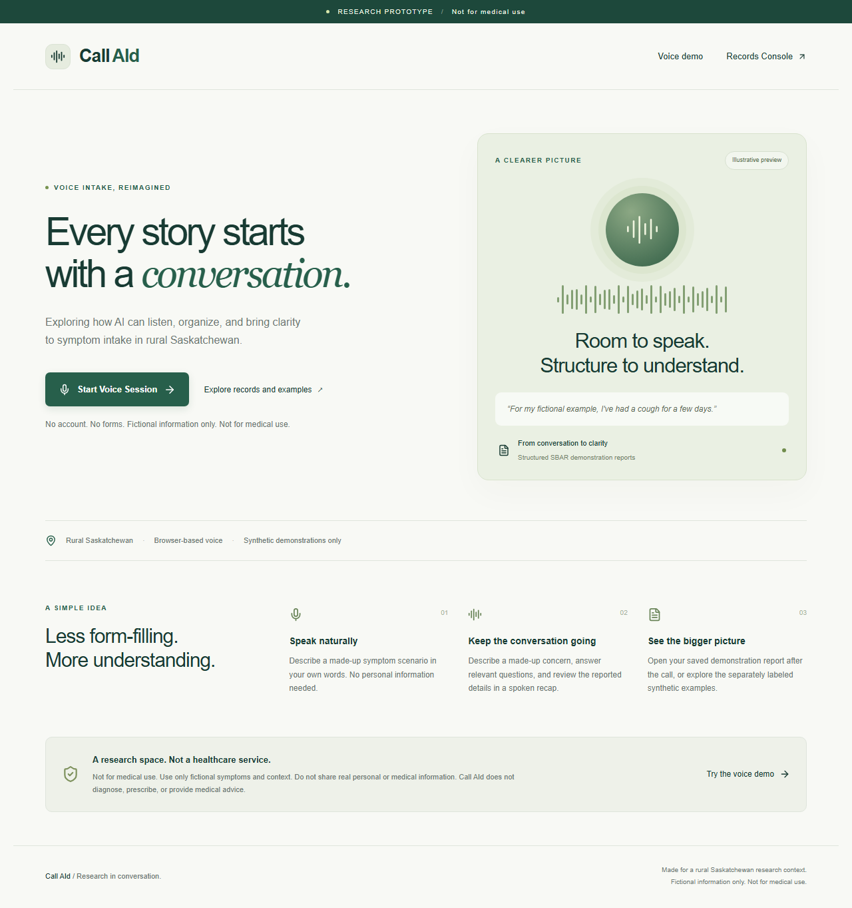
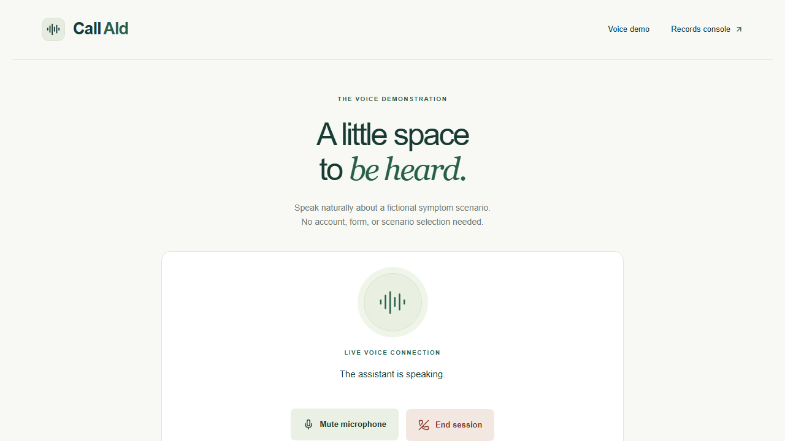
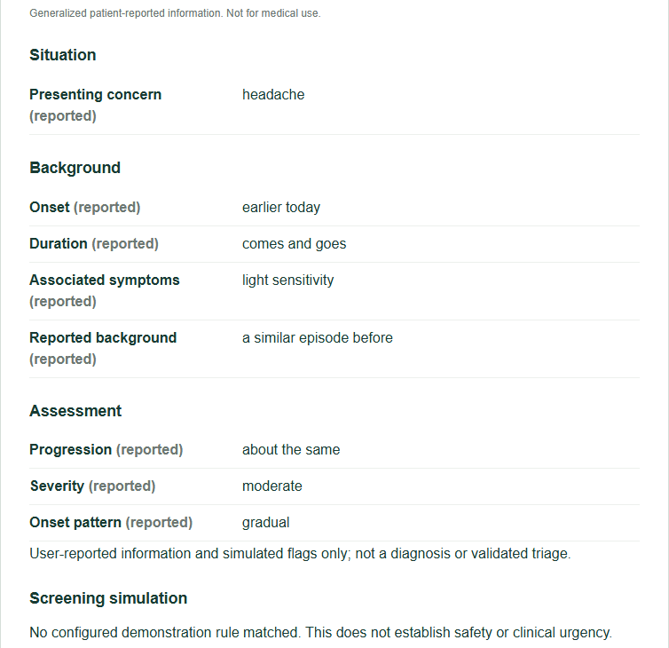
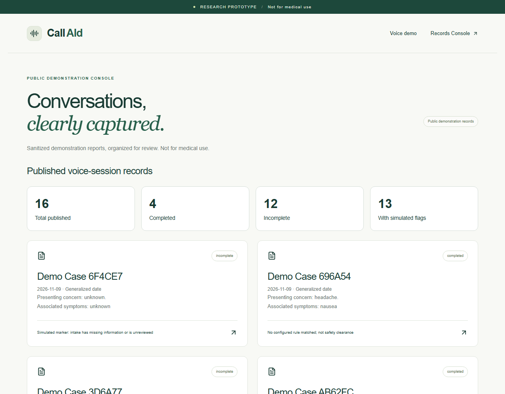
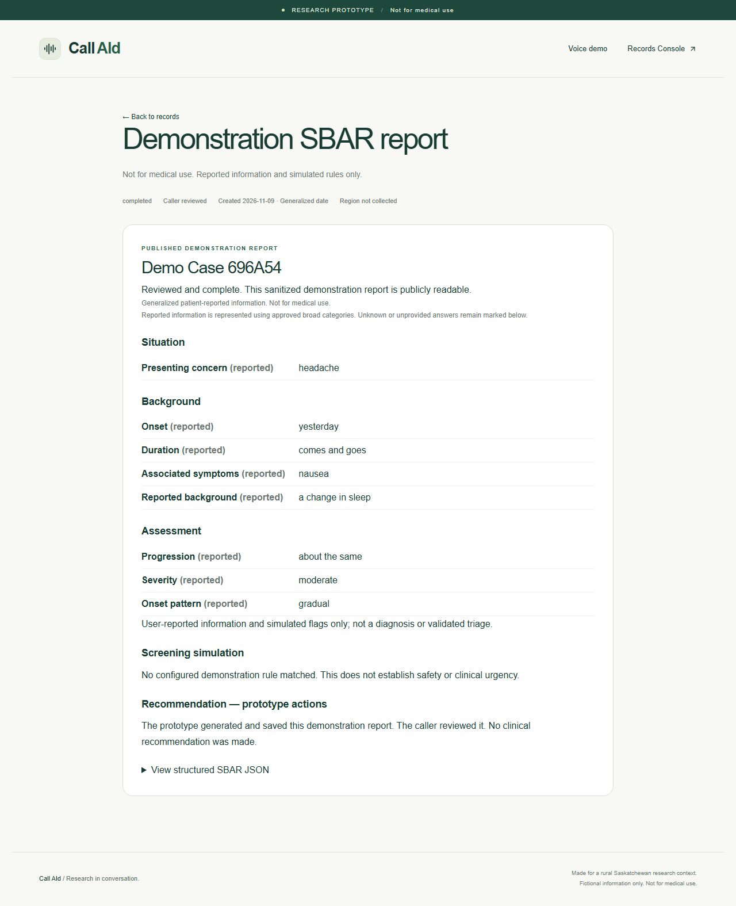
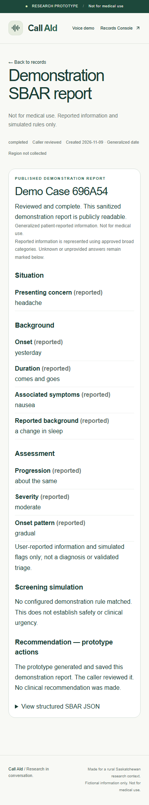
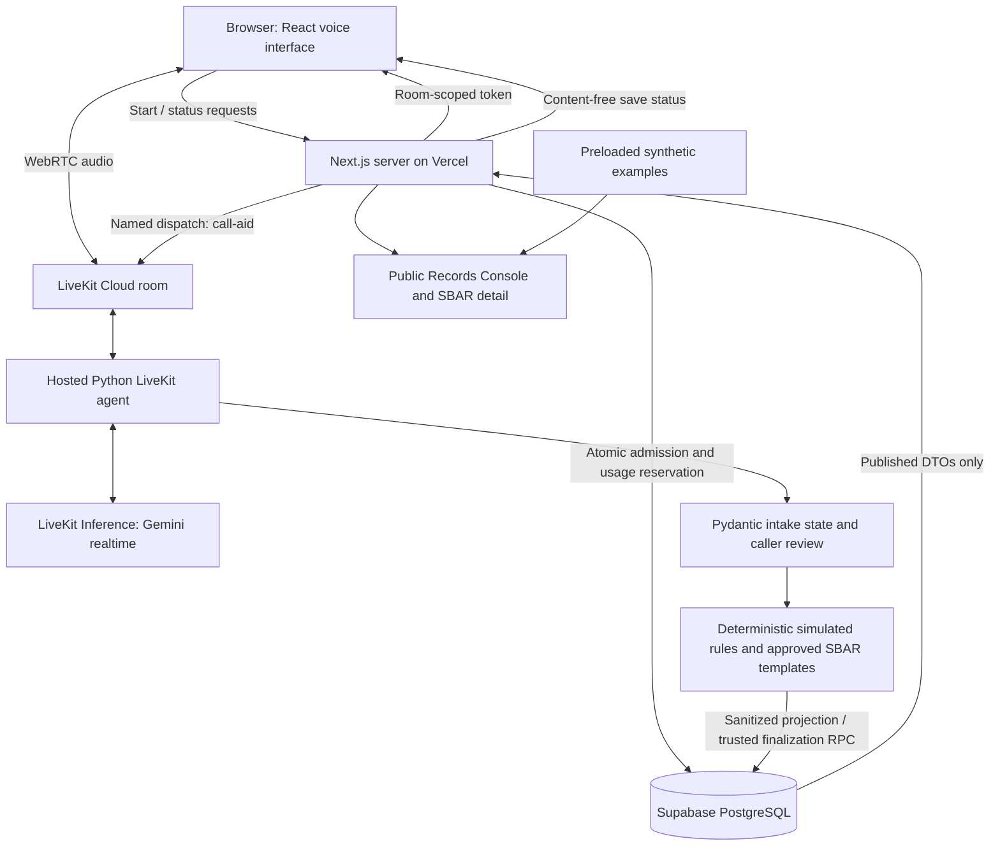

# Call AId

Call AId is a voice-first AI healthcare intake prototype developed to explore more accessible symptom information gathering for rural and remote communities. Through natural voice conversations, the system collects structured patient-reported information, applies demonstration screening rules, and generates standardized SBAR reports that can be reviewed through a web-based Records Console.

> **Not for medical use.** A research demonstration using fictional information only. No diagnosis, treatment advice, clinically validated triage, real patient processing or telephone connectivity.

**Start here:** scroll through the walkthrough below. No running voice service is needed to understand the prototype. [Technical setup](docs/DEVELOPMENT.md) · [Hosted test evidence](MILESTONE_4_REPORT.md) · [Project plan](PROJECT_PLAN.md)

## The Problem

Distance and travel burden can complicate access to healthcare in rural and remote communities. [CIHI's Canadian travel-burden analysis](https://www.cihi.ca/en/what-is-travel-burden-and-how-does-it-vary-throughout-canada) describes how geography can become an access barrier. Call AId explores one small part of that problem: making initial symptom information easier to express and organize. It does not replace access to a health professional, and improved access or clinical outcomes have not been established by this prototype.

## Our Solution

A person speaks naturally instead of completing a long intake form. The assistant asks relevant follow-up questions, checks important details through a spoken recap and turns validated, generalized responses into an SBAR report: **Situation, Background, Assessment and Recommendation**.

The current implementation runs in a **web browser with a microphone**. The long-term concept includes ordinary telephone calls, but there is no implemented phone number, SIP/telephone connection, emergency integration or referral pathway. The current Records Console is public and contains sanitized demonstrations only.

## How It Works

1. **Open the website.** Review the research notice; no account, scenario selection or acknowledgement form is required.
2. **Start a voice session.** The browser requests microphone permission. The Next.js server checks capacity and budget, reserves a session and issues a short-lived, room-scoped LiveKit token.
3. **Describe an invented concern.** The hosted Python agent asks one relevant question at a time about onset, progression, impact, associated symptoms and context.
4. **Review and correct.** Python validates structured updates with Pydantic. The assistant recaps the reported information and invites corrections; unknowns remain unknown.
5. **Generate SBAR.** Versioned Python rules produce simulated flags. Approved templates assemble the public report from validated categories, without unrestricted AI narratives.
6. **Save through Supabase.** Trusted server-side functions finalize one stable case per session, including safe incomplete cases. Saving/publication status comes from the actual database result.
7. **Open the report.** The browser checks final status and shows **View Generated Record** only after a confirmed save. The same case appears in the Records Console.

**Journey:** Landing → Voice Session → Guided Intake → SBAR → Supabase → Records Console → Detailed Report.

## Application Screenshots

All shown information is synthetic. Fresh captures use the actual local production build and existing hosted demonstration records. The voice and intake images are **genuine archival milestone captures**, identified below; they do not imply that inference is available today. No new inference session was started for these screenshots. [Capture provenance and dimensions](docs/SCREENSHOTS.md).

### 1. Landing page



The entry point explains the idea, displays the research boundary and offers routes into voice or records without an account.

### 2. Connected voice session — archival



An actual earlier milestone browser connection with synthetic microphone input, showing the assistant speaking and mute/end controls. This is a historical interface capture; the current implementation also includes microphone selection and an input meter. It is not a newly simulated connection or evidence of current credit availability.

### 3. Guided intake — archival structured output



Reported details from a genuine Milestone 2 conversation: headache, onset, duration, associated symptoms, background and severity. This is a crop of its structured-output view, not a text-chat transcript. The conversation itself is spoken. Later milestones added confirmed database persistence; this image does not claim that this earlier intake was saved.

### 4. Records Console



The current console reads actual published demonstration records from Supabase, separates completed and incomplete cases, and labels simulated flags. Snapshot: 16 generated records, including 4 completed cases. Preloaded examples are separately labelled further down the page and excluded from these statistics. Counts are not real patient activity.

### 5. Saved SBAR report



This is case `696a540c-beed-4696-a989-de6f2c08b039`, created by the verified hosted voice test. Its approved public JSON was independently read and validated after saving. Reported facts, simulated screening and prototype actions are distinct; the Recommendation accurately says the report was saved. Generated records expire after seven days, so the screenshot remains useful after the case URL expires.

### 6. Responsive mobile report



The same report at a 390-pixel mobile viewport, with stacked fields and readable section headings. This verifies responsive rendering, not a physical mobile microphone test.

## Core Features

| Feature | Implementation |
| --- | --- |
| Browser voice conversation | LiveKit audio transport and a named Python agent; microphone selector, input meter, mute/end controls |
| Guided intake | Adaptive questions, validated field updates, corrections, unknown/declined values and reviewed recap |
| Screening simulation | Separate deterministic, versioned Python rules; no clinical urgency or safety clearance |
| SBAR generation | Pydantic contracts and approved templates grounded in caller-reported categories |
| Supabase persistence | JSONB public projection, one record per session, idempotent finalization and truthful save results |
| Records Console | Public list/detail routes, actual statistics, completed/incomplete states and dynamic refresh |
| Offline exploration | Curated synthetic examples available without a voice connection or cloud credentials |
| Infrastructure controls | Server-only secrets, restricted tokens, trusted database writes, configurable admission limits and kill switch |

Public routes: `/` · `/demo` · `/records` · `/records/[id]`. “Public” describes application behavior; the current hosted Preview is additionally protected by Vercel pending release approval.

## Technology Stack

| Layer | Technology |
| --- | --- |
| Web interface | Next.js 15.5.28, React 19, TypeScript, Tailwind CSS 4 |
| Voice transport / hosting | LiveKit Cloud and Python LiveKit Agents SDK |
| Realtime voice model | Gemini through LiveKit Inference; tested configuration `google/gemini-3.8-live`, voice `Puck` |
| Workflow and validation | Python 3.12, Pydantic, deterministic rules; runtime Zod validation in the web app |
| Storage | Supabase PostgreSQL, private tables and service-only RPC functions |
| Web deployment | Vercel, with `web/` as the project root |
| Delivery and testing | GitHub Actions, pnpm, uv, pytest, Ruff, Vitest, PGlite and Playwright |

The project adapts the official [LiveKit React/Next.js starter](https://github.com/livekit-examples/agent-starter-react) and [Python starter](https://github.com/livekit-examples/agent-starter-python). Licenses and pinned upstream revisions are recorded in the [developer guide](docs/DEVELOPMENT.md#starter-and-skill-provenance).

## System Architecture



The model phrases questions and proposes updates; Python controls state, validation and completion. Database confirmation controls saved/publication fields. Private session bookkeeping stays separate from the public JSON. Supabase's `private` schema is not exposed through the Data API: narrowly granted `public` RPC functions access it using trusted server credentials. No anonymous table access or browser writes.

Public reports contain generated case labels and generalized categories/dates, not caller-supplied names, exact locations or raw transcripts. Broad regional information is possible in curated examples; generated voice records currently leave region uncollected. Unsupported details are generalized or omitted, never invented. Audio and transcripts are not stored by the application; cloud audio processing still occurs. This is not a privacy or Canadian-residency guarantee.

## Example SBAR Output

An **abbreviated excerpt** from the repository's [full synthetic published fixture](contracts/fixtures/published.json). Omitted fact arrays/version fields are present in the full schema-valid file. This fixture is an example, not a database write or a real patient record.

```json
{
  "schema_version": "3.0",
  "case_id": "b0000000-0000-4000-8000-000000000002",
  "demonstration_label": "Demo Case B00000",
  "status": "completed",
  "reviewed": true,
  "publication": "published",
  "situation": {
    "text": "Presenting concern: headache."
  },
  "background": {
    "text": "Onset: earlier today. Duration: comes and goes. Associated symptoms: light sensitivity. Reported background: no similar episode reported."
  },
  "assessment": {
    "disclaimer": "User-reported information and simulated flags only; not a diagnosis or validated triage.",
    "missing_information": [],
    "simulated_flags": [
      {
        "code": "DEMO_SUDDEN_HEADACHE",
        "label": "Simulated marker: headache with reported sudden onset",
        "evidence_fields": [
          "chief_complaint",
          "onset_pattern"
        ]
      },
      {
        "code": "DEMO_MAJOR_IMPACT",
        "label": "Simulated marker: severe symptoms or major activity impact reported",
        "evidence_fields": [
          "severity"
        ]
      },
      {
        "code": "DEMO_WORSENING",
        "label": "Simulated marker: worsening was reported",
        "evidence_fields": [
          "progression"
        ]
      }
    ]
  },
  "recommendation": {
    "record_saved": true,
    "text": "The prototype generated and saved this demonstration report. The caller reviewed it. No clinical recommendation was made."
  }
}
```

The canonical [Pydantic models](agent/src/intake_schema.py) generate [JSON Schema](contracts/sbar.schema.json). `publication`, `record_saved` and saved recommendation text are derived from trusted persistence results, not selected by the language model.

## Project Structure

```text
call-aid/
├── web/                    # Next.js pages, voice controls, server APIs and tests
│   ├── app/                # Landing, demo, records, SBAR details and session APIs
│   ├── components/         # Microphone, report and result views
│   ├── lib/                # Admission, trusted DB access and strict public DTOs
│   └── e2e/                # Cloud-free desktop/mobile browser checks
├── agent/                  # Independent Python/uv project and LiveKit container
│   ├── src/                # Intake workflow, schemas, rules, SBAR and persistence
│   └── tests/              # Workflow, privacy, validation and persistence tests
├── contracts/              # Generated schema, approved labels and synthetic fixtures
├── supabase/migrations/    # Append-only database migrations 001–004
├── docs/                   # Screenshots, setup and manual deployment guide
└── .github/workflows/      # Cloud-free CI and manual LiveKit deployment
```

## Getting Started Locally

### Prerequisites

Git, Node.js 24, pnpm 9.15.9, Python 3.12 and uv. A LiveKit Cloud project is needed for real voice; a Supabase project is needed for saved records. The LiveKit CLI is used for agent operations. Docker and the Supabase CLI are optional for the full disposable local database stack; SQL tests also run without Docker through PGlite.

### Run the website and synthetic examples

```powershell
git clone https://github.com/fikunmi-2/call-aid.git
cd call-aid/web
pnpm install --frozen-lockfile
Copy-Item .env.example .env.local
# Keep DEMO_ENABLED=false to explore without using inference credits.
pnpm dev
```

Open `http://localhost:3000`. Examples work without credentials; generated-record queries show a clear unavailable state until Supabase is configured. Copy env templates only on fresh setup; preserve existing configured files.

### Configure actual voice and persistence

Use [web/.env.example](web/.env.example) and [agent/.env.example](agent/.env.example). Examples below are placeholders; secrets are server-only and must never use a `NEXT_PUBLIC_` prefix.

| Variable | Where | Example / purpose |
| --- | --- | --- |
| `APP_ORIGIN` | Web | `http://localhost:3000`; must match the browser origin |
| `DEMO_ENABLED` | Web | `false` until database, worker and credits are ready |
| `LIVEKIT_URL` | Web and local agent | `wss://your-project.livekit.cloud` |
| `LIVEKIT_API_KEY`, `LIVEKIT_API_SECRET` | Web and local agent | Your server credentials, entered privately |
| `LIVEKIT_AGENT_NAME` | Both | `call-aid`, identical on both sides |
| `SUPABASE_URL`, `SUPABASE_SECRET_KEY` | Both | Hosted URL and server-only secret/service-role key |
| `SESSION_HMAC_SECRET` | Web | At least 32 random bytes, entered privately |
| `REALTIME_MODEL`, `REALTIME_VOICE` | Agent | Tested model and compatible voice shown above |

Apply migrations in filename order to a **new development database** after review. Use the Supabase SQL Editor or link the CLI and inspect `supabase db push --dry-run` before applying. Migrations 001–004 are already applied to this project's hosted database; do not reset or reapply them. For a fresh disposable local stack, use `supabase start`, then `supabase db reset`. Never reset a hosted project as routine setup.

In a second terminal:

```powershell
cd call-aid/agent
uv sync --locked
Copy-Item .env.example .env.local
# Fill the required server credentials privately.
uv run src/agent.py dev
```

Configure the web env, set `DEMO_ENABLED=true` only with available credits, then restart Next.js. Start through `/demo` so the worker receives a valid server reservation. An arbitrary Playground room is intentionally rejected. Local voice still uses cloud inference and consumes credits.

### Run cloud-free checks

```powershell
# In web/
pnpm lint
pnpm typecheck
pnpm test
pnpm build
pnpm exec playwright install chromium
pnpm test:e2e

# In agent/
uv run ruff check src tests export_contract.py
uv run ruff format --check src tests export_contract.py
uv run pytest
```

These tests use synthetic data, mocked cloud boundaries and disposable SQL state. They do not establish current inference availability. Full environment, limit, debugger, retention and troubleshooting instructions are in [Development and operations](docs/DEVELOPMENT.md).

## Deployment

**Vercel:** use `web/` as Root Directory, Next.js detection, Node 24, `pnpm install --frozen-lockfile` and `pnpm build`. Enter privileged variables through Vercel's supported sensitive-env workflow. Preview and Production settings are separate. Explicitly target Preview with `vercel deploy --environment preview`; the first deployment can otherwise become production. Final production publication requires owner approval.

**LiveKit Cloud:** reuse `agent/livekit.toml` and the existing agent. The official pinned `livekit/deploy-action` uploads/builds from GitHub's hosted runner, avoiding the laptop's ISP upload restriction without disabling TLS. It is **manual `workflow_dispatch` only**, not deployment on every push. The five GitHub secrets and trigger steps are documented in [Manual LiveKit deployment](docs/LIVEKIT_GITHUB_DEPLOY.md). No additional model-provider account is required for LiveKit Inference. LiveKit injects its own runtime connection credentials; Supabase credentials use agent secrets.

**Supabase:** retain private tables, RLS and service-only RPC grants. Published JSONB records are linked one-to-one to private sessions. Configure daily trusted cleanup; expired records are filtered immediately, but scheduled deletion still needs verification. Never grant anonymous table writes or commit env files.

The existing deployments were not resumed, promoted or reconfigured for this documentation work. Vercel's GitHub app connection still needs owner repository authorization if automatic deployment is desired; current pushes do not auto-deploy that project.

## Current Status and Limitations

Status as of **November 9, 2026**:

| Area | Verified status |
| --- | --- |
| Core workflow | Implemented: voice, adaptive intake, reviewed recap, deterministic flags, validated SBAR, trusted save and console |
| Hosted end-to-end | Passed once on a protected HTTPS Preview, using synthetic microphone audio, hosted agent and a newly saved case; local workers stopped |
| Current inference | Owner reports included Build credits nearly exhausted. Later realtime and optional STT checks returned HTTP 429. Live voice is not currently promised |
| Deployed agent | Existing agent Running on last inspection, version `GqvhsuGZ4Dvy`; deployment health alone does not prove model availability |
| Public judge URL | Not released. Vercel project paused, production voice disabled; Preview remains protected |
| Screenshots | Current local UI plus explicitly labelled archival voice/intake captures; no new inference used |
| Current polish | Verified locally; not deployed to production by this change |

The repository is the primary review experience while credits are constrained. [Milestone 4](MILESTONE_4_REPORT.md) records actual deployment runs, acceptance evidence and failed/unverified checks. [Repository showcase report](docs/REPOSITORY_SHOWCASE.md) records this cleanup and its tests.

Important limits:

- **Research only:** no real patients, clinical validation, diagnosis, prescriptions, safety clearance or clinical follow-up. A simulated flag is a configured rule match, not an urgency assessment.
- **Probabilistic extraction:** clarification and caller review matter. The model can miss details; approved categories deliberately sacrifice nuance. Unknown is not a negative finding.
- **Public demonstrations:** no raw transcripts, audio recordings, names, health identifiers or exact locations in public records. Generated labels and generalized dates reduce detail but do not guarantee anonymity. Public content can be copied.
- **Truthful outcomes:** only confirmed database saves create successful report links. Incomplete, withheld, failed and pending states remain distinct. The exact hosted farewell wording was not verified because the optional transcription check failed.
- **Resource limits:** configurable defaults include one concurrent call, 180 seconds, idle/turn limits, two starts per ten minutes, daily caps, a $2 estimated monthly reservation allowance and `DEMO_ENABLED` kill switch. Estimated reservations are not actual billing caps. No paid subscription or automatic upgrade enabled.
- **Verification boundaries:** browser tests use synthetic microphones; physical mobile audio, accents/noise and actual hosted outage handling remain manual checks. Daily deletion scheduling and project-wide observability settings need owner review.

## Future Development

These are research directions, **not implemented features or approved clinical use**:

- Ordinary telephone access, subject to separate design, cost and safety review.
- Clinician-reviewed intake workflows and evaluation with qualified collaborators.
- Secure clinical access, consent and appropriate access controls for any future healthcare system, separate from this public synthetic console.
- Accessibility, language and speech-quality evaluation with diverse users.

Any real patient processing or clinical deployment would require a substantially different privacy, governance and validation process. This repository does not establish readiness for it.

## Origin

Developed for the **University of Regina GATE Health Tech Innovation Challenge — November 2026**, with rural Saskatchewan as the initial research context.

[Milestone 1](MILESTONE_1_REPORT.md) · [Milestone 2](MILESTONE_2_REPORT.md) · [Milestone 3](MILESTONE_3_REPORT.md) · [Milestone 4](MILESTONE_4_REPORT.md) · [Publication policy](PUBLICATION_UPDATE.md)
